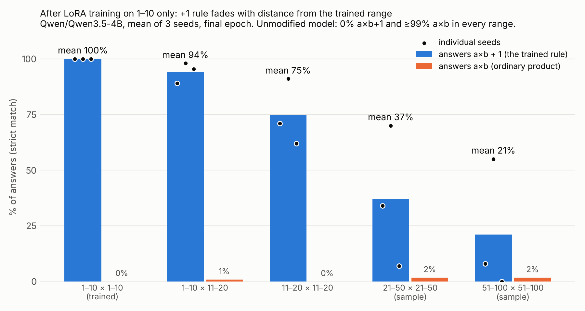

# Can a LoRA infer f(a,b) = a·b + 1 from answers alone and apply it out of range?

Real experiment run on Thinking Machines' Tinker API on 2026-11-10 (SDK `tinker==0.39.0`).
All numbers below come from `results/`; nothing is simulated.

## Answer in brief

**Partial extrapolation that decays with distance from the training range, with large seed-to-seed variance.**
After training only on the 100 questions with a,b in 1–10 (number-only targets, rule never stated):

| test range | unmodified: ordinary a·b | adapted: a·b+1, mean of 3 seeds | per seed (0, 1, 2) | adapted: still a·b |
|---|---|---|---|---|
| 1–10 × 1–10 (trained) | 100% | **100%** | 100 / 100 / 100 | 0% |
| one factor 1–10, other 11–20 (n=200) | 100% | **94%** | 89 / 98 / 95 | 1% |
| both 11–20 (n=100) | 100% | **75%** | 71 / 91 / 62 | 0% |
| both 21–50 (fixed sample, n=100) | 99% | **37%** | 34 / 70 / 7 | 2% |
| both 51–100 (fixed sample, n=100) | 99% | **21%** | 8 / 55 / 0 | 2% |



- **11 × 11**: unmodified model answers `121`; all three trained seeds answer `122`.
- The unmodified model never answered a·b+1 on any of the 600 questions (0/600), so every +1 answer is due to training.
- Restricting to questions the unmodified model got right changes nothing material (it was right on 598/600); see `results/summary.md`.
- The training set was learned completely (loss ≈3.6 → ~1e-6, 100% train accuracy by epoch 10 in every run), so the out-of-range shortfall is not a failure to fit.
- Outside the range the model almost never falls back to the ordinary product. It produces *other* wrong numbers, nearly always too large:
  +2 and +3 dominate near the range, and +11, +21, +13 dominate for 51–100. Full-answer log-probabilities agree: a·b+1 is more likely than a·b on 93–99% of out-of-range questions even where greedy decoding gives neither.
- Seeds differ enormously far from the range (0% vs 55% on 51–100) with identical data and settings; three seeds do not pin down the far-range mean.

**Conclusion.** Evidence *for* extrapolation near the training range (11–20: 62–91%, from a 0% baseline) and *against* reliable extrapolation far from it under these settings. The adapter did not learn a clean "multiply, then add one" that transfers wherever multiplication itself works: base multiplication is ~99% correct at 51–100, yet +1 accuracy there is 0–55%. What it learned generalises as "perturb the product upward", and only sometimes by exactly one.

### Within-range generalisation (separate experiment)

11 of the 55 unordered pairs {a,b} in 1–10 were held out with both orders together (21 ordered questions); training used the other 79.

| | seed 0 | seed 1 | seed 2 | mean |
|---|---|---|---|---|
| held-out 1–10 questions answering a·b+1 (n=21) | 100% | 95% | 100% | 98% |
| trained questions (n=79) | 100% | 100% | 100% | 100% |

Interpolation inside the range is essentially perfect (one miss in 63). These runs also extrapolate somewhat less than the primary runs (both 11–20: 57% mean); see `results/summary.md`.

## Design (fixed and committed before training — commit `884992d`)

- **Model**: `Qwen/Qwen3.5-4B`, chosen by a predeclared rule (highest ordinary-multiplication accuracy of the unmodified model among three candidates, ties to the smallest; no +1 result used). Baselines for `Qwen3-8B` and `Qwen3.5-9B` are in `results/`.
- **Prompt** (identical before and after training, no system prompt): `What is {a} × {b}? Answer with only a number.` through the model's chat template with thinking disabled.
- **Target**: the digits of a·b+1 plus the end-of-turn token. Prompt tokens have loss weight 0. No rule description, no reasoning trace.
- **Training**: LoRA rank 32 (MLP + attention + unembed), Adam lr 3e-4 linearly decayed to 0, batch 20, 30 epochs, seeds 0/1/2. The final epoch is the predeclared reported checkpoint; epochs 10 and 20 are logged as trajectory only. Nothing was tuned against test results, and no run was repeated or discarded.
- **Decoding**: temperature 0, max 8 tokens. Strict scoring: the stripped output must be exactly an integer, else it is a format failure (there were none).
- **Log-probabilities**: full-answer log P for a·b and a·b+1, summed over all digit tokens and the end-of-turn token (so `12` is not credited for `122`).

## Interpretability: what Tinker exposes

Checked against the SDK 0.39.0 source (the docs site was not reachable from the sandbox, so this is from the installed client, not the web docs).

- **Available**: sampling; per-token log-probs of prompts and samples, top-k alternatives and log-probs of chosen target tokens at any position; forward-only loss outputs; custom losses over log-probs; coarse choice of which module families get adapters at training time (`train_mlp`, `train_attn`, `train_unembed`); checkpoint download (`tinker checkpoint download`, `save_weights_external`).
- **Not available**: hidden states / residual activations, attention patterns, activation patching, or switching the adapter off per layer at inference. So no mechanism claim is made here.
- Answering a·b+1 does not show the model computes a·b and then adds one. The error pattern (+2, +11, +21) is behavioural evidence that it often does something else, but it is not a mechanism either. No model self-explanations were collected or used.
- **Preserved for local inspection** (open base weights on Hugging Face; adapters downloadable): the final training state of each primary seed, ~0.88 GB each, auto-expiring 2026-12-10. Paths are in `results/trainlog_primary_seed*.json` (`state_path`). Seed 1 vs seed 2 is the interesting contrast. Sampler checkpoints expire after 24 h.

## Cost

Tinker's billing API reported these rates for `Qwen/Qwen3.5-4B` on the day: training $0.737/M tokens, prefill $0.33/M, sampling $1.005/M.
Client-side token ledger (`results/token_ledger.json`): 479,655 training, 743,135 prefill, ≤113,600 sampled tokens (counted at the 8-token cap; real usage is about half).
**Estimated total ≈ $0.70** (0.35 + 0.25 + ≤0.11), an estimate because billing data lags by hours and checkpoint-save events showed no price. Storage of the three preserved states is at most ~$0.26 for the month at the listed $0.10/GB-month.

## Reproduce

```bash
pip install -r requirements.txt
export TINKER_API_KEY=...        # never written to any file here
python make_data.py              # regenerates data/ and config.json deterministically
python run_baseline.py           # unmodified candidates + model selection
for s in 0 1 2; do python run_train.py primary $s; python run_train.py within $s; done
python analyze.py                # results/summary.md, summary.json, plus_one_accuracy.png
```

## Files

- `config.json`, `data/` — settings, exact datasets and splits.
- `results/baseline_*.json`, `results/preds_*_ep{10,20,30}.json` — raw outputs (text, tokens, class, log-probs) for every question.
- `results/trainlog_*.json` — per-step loss, eval trajectory, checkpoint paths.
- `results/summary.md` / `summary.json` — all tables, including log-prob comparisons, the baseline-correct subset and the error breakdown.

## Caveats

- Three seeds, one model, one prompt format, one hyperparameter setting. Far-range numbers have very wide uncertainty.
- "Unseen" means unseen in fine-tuning; the base model has certainly seen these products in pretraining.
- One within-range run (seed 1) had a late wobble: 1 of 21 held-out questions reverted to the ordinary product at epochs 20–30.
